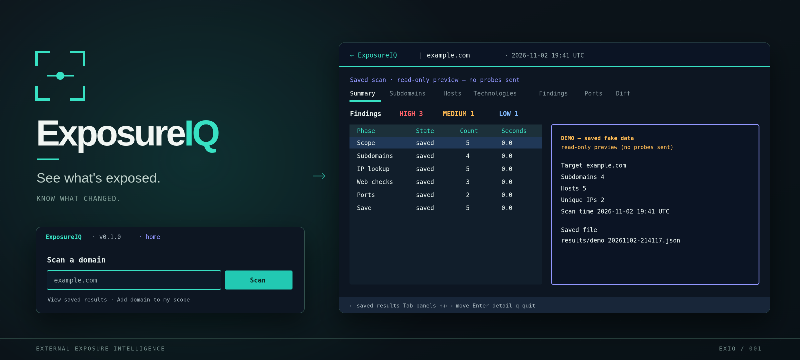

# ExposureIQ 



**Discover your attack surface. Track what changes. Turn findings into reports.**

An open-source attack surface management (ASM) tool written in Python: a
deterministic scanner, scan-to-scan diffing, and built-in HTML/PDF/DOCX reporting
engine. An optional, advisory-only AI layer is planned; it will only draft text
from structured findings and will never scan or act.

**Status:** active development. Stages 1–4 (discovery, checks, diffing, reports)
are implemented. Python 3.10+, MIT license.

---

## Why ExposureIQ?

Most organizations do not know everything they expose to the internet, and they
notice changes too late: a forgotten staging subdomain, a database port opened
"temporarily", a service that quietly went out of date.

ExposureIQ is built around three ideas:

1. **Discover** external assets: subdomains, IP addresses, open ports, and services.
2. **Diff** two scans to show what is new, changed, or gone.
3. **Report** the result as a clear document for engineers and decision makers.

### Design principles

- **The scanner is deterministic.** Same input, same behaviour. No AI is involved
  in discovery, probing, or severity decisions.
- **AI is optional and advisory.** The planned AI layer only reads structured
  findings and writes draft text. It never chooses targets, runs tools, or acts.
- **Local-first.** The AI layer is designed for local models (via Ollama), so
  scan data does not have to leave the machine.
- **One shared schema.** Every stage reads and writes the same versioned JSON
  format, so parts can be extended independently.
- **Humans stay in the loop.** Findings and report text are evidence for review,
  not automatic proof of a vulnerability.

---

## Features

| Area | Capability | Status |
| --- | --- | --- |
| **Discovery** | Subdomain enumeration (Subfinder, with a crt.sh fallback) | Done |
| | DNS resolution (A and AAAA) | Done |
| | Top-100 TCP port scan with Nmap, scope-gated | Done |
| **Fingerprinting** | Technology hints from headers and HTML | Done |
| | Security-headers check | Done |
| | HTTPS certificate checks | Done |
| | Risky-service rules on open ports | Done |
| | Severity, recommendation, and scan wiring | Done |
| **Storage** | Versioned JSON snapshots (schema 0.1 and 0.2) | Done |
| **Diffing** | New, changed, and removed assets, ports, technologies, findings | Done |
| | Ignore rules and confirmed-removal checks | Done |
| | Diff view in the terminal UI | Done |
| **Reporting** | Offline domain dashboard with dated scan cards, newest first | Done |
| | Findings table with severity colours | Done |
| | "What changed" section from the Stage 3 summary | Done |
| | Interactive charts: severity, hosts and findings over time | Done |
| | PDF export with no external PDF dependency | Done |
| | Automatic PDF after a successful scan | Done |
| | `exposureiq report` command | Done |
| | TUI Export picker for animated HTML and editable DOCX | Done |
| | Custom report templates | Planned |
| **AI (optional)** | Risk prioritisation and plain-language drafting | Planned |

---

## Quick start

**Windows:** after cloning, run `.\run.bat install`. See the
[Windows helper](#windows-helper) for Nmap's confirmation prompts and setup checks.
The manual setup below is for Linux/macOS.

```bash
git clone https://github.com/ExposureIQ-Project/ExposureIQ.git
cd ExposureIQ
python -m venv .venv
source .venv/bin/activate          # Linux/macOS; see the Windows helper below
pip install -e ".[dev]"

# 1. Scan a domain you own or are authorised to test.
exposureiq scan example.com

# 2. See what changed from the first saved scan through the newest.
exposureiq diff example.com

# 3. Generate an HTML and PDF report from the newest saved scan.
exposureiq report example.com

# Or choose the files explicitly.
exposureiq report results/example.com/example.com_2026-10-13T20-15-00Z.json -o assessment.pdf
```

`scan` groups JSON by domain in `results/<domain>/` (git-ignored). After a
successful save it also builds a PDF in `report/<domain>/` (git-ignored).
`report` writes there by default too:

- `report/<domain>/index.html` — one offline home page for all the domain's scans
- `report/<domain>/<target>_<scan-id>.pdf` — the selected scan
- `report/<domain>/<target>_<scan-id>.docx` — the selected scan, when requested

Different domains stay separate. Legacy flat JSON files remain readable and are
not moved. An explicit `scan -o exact.json` filename stays exact; a directory
output such as `-o custom/` groups snapshots in `custom/<domain>/`.

Use `scan --no-report` if you only want the JSON snapshot.

After a scan, use **Export** in the TUI's top-right corner (or press `e`) and
choose **HTML** or **DOCX**. HTML refreshes the domain's `index.html`: dated scan
cards appear newest first, and each opens that scan's detail view. DOCX uses the
same target/scan-ID name as the default PDF. Saved-scan previews can export too.
Exports only read saved JSON; they never run another scan or change existing PDFs.
The button is disabled when saving was skipped or failed.

To copy from the terminal UI, **drag-select text and release the mouse**. The
highlighted text is copied automatically, including table and input-box text.
A small **Text copied** notification appears at the top right, below the header.
No shortcut is needed; **Ctrl+Shift+C** and **Ctrl+Insert** remain available for
manual copying.
**Ctrl+C** still quits/cancels, and Escape clears a text selection.

**Double-click a scan-results row** to copy just its hostname, not the whole
table or its other columns. The grouped Hosts table copies the first listed hostname;
rows with only an IP address copy that IP. Headers and empty rows copy nothing.

**View saved results** is a file browser: single-click chooses a scan;
double-click (or Enter) opens it without selecting or copying text.

Desktop copying uses `wl-copy` on Wayland, `xclip`/`xsel` on X11, `pbcopy` on macOS,
or PowerShell on Windows. Wayland and X11 are Linux display systems. No new
Python dependency is required. Without a local clipboard tool (or over SSH), the
app sends a terminal clipboard message (OSC 52); support depends on your terminal.
If copying still fails, hold **Shift** while
dragging to select with the terminal itself, then press **Ctrl+Shift+C**.

HTML opens offline as a responsive dashboard matching the app's dark/teal
styling. Hover a chart to see a snapping dashed cursor, scan number and UTC date;
click a point to jump to its history changes. Charts grow when first scrolled
into view, with reduced-motion support. DOCX follows the PDF's styling with a dark
branded cover, organized sections, colored tables, and editable severity/host/finding
charts. Text, recommendations, inventory, changes, and chart-data tables stay editable.

Useful report options:

```bash
exposureiq report example.com --format html      # HTML only
exposureiq report example.com --format pdf       # PDF only
exposureiq report example.com --format docx      # editable Word report
exposureiq report example.com -o out/report.html # explicit file (format inferred)
exposureiq report example.com --compare old.json # explicit older scan
exposureiq report example.com --no-diff          # disable comparisons
```

The report command is offline: it reads saved JSON and never sends traffic.
Reports and domain diffs use the first compatible saved scan as the baseline,
then include each intermediate comparison. Each scan's detail view, PDF, DOCX
or diff for scan 3 only uses scans 1–3, even if scans 4–10 are already saved.
The HTML home lists all saved scans, with real and demo trends kept separate.
Explicit `--compare` or
`diff OLD.json NEW.json` still selects your chosen baseline.

### Windows helper

On Windows 10/11, open PowerShell or Command Prompt in the cloned folder
containing `pyproject.toml`, then run:

```powershell
.\run.bat install
.\run.bat doctor
.\run.bat
.\run.bat demo
.\run.bat scan example.com --passive
.\run.bat test
.\run.bat help
```

`install` sets up everything needed by ExposureIQ:

- Reuses a working Python 3.10+, or installs Python for the current user if missing.
- Creates/reuses `.venv` and installs ExposureIQ and its test dependencies.
- Installs the correct Subfinder binary for x64, ARM64, or x86.
- Opens the official Nmap installer if no working Nmap is found. **Complete its
  license/Windows administrator prompts and keep the default install location.**
  Nmap's installer supplies its required Visual C++ runtime. The free Nmap
  installer is not silently installable; these confirmation prompts are expected.
- Checks that Python packages, Subfinder, and Nmap are ready before saying setup
  is complete. Setup never scans a target or changes scope files.

Downloads come from the official publishers, with pinned versions and SHA-256
checksums (file-integrity checks) recorded in `scripts/windows-tools.json`.
Downloaded installers and Subfinder stay in git-ignored `.tools/`. Installed
Python lives under `%LOCALAPPDATA%\Programs\ExposureIQ\`. No Git, Go, WinGet,
virtual-environment activation, or manual `PATH` editing is required to run the
helper. Each launch makes installed tools visible to ExposureIQ for that process
only. Nmap may need administrator approval; the entire helper is not elevated.

For demos/passive discovery without Nmap installation, use
`.\run.bat install --python-only`. With Python available, run commands also set
up the Python environment automatically. `demo` uses fake example.com data;
`test` runs offline tests. Neither requires Nmap or Subfinder. Existing
incompatible environments or corrupt cached files are not silently overwritten.

`doctor` only checks local dependencies: it does not install anything, contact a
target, or verify network access. A complete installation cannot prevent crt.sh
timeouts/502 responses or a target refusing its front-page request. Subfinder
reduces reliance on crt.sh, but its own sources can also fail or require API keys.
Missing results must never be treated as proof of safety.

Helper `scan` commands are passive by default. Add `--active` only for domains
you own or have written permission to test; the existing `scope.txt` checks still
apply. The helper never changes scope files. `diff`, `report`, `scope`, `--open`,
and `--version` also pass their arguments to ExposureIQ. Quoted paths and options
such as `demo --plain` work too.

`run.bat` calls `run.ps1` using Windows PowerShell 5.1+ with an execution policy
for that process only; it does not change your saved security settings. You can
also run `.\run.ps1 demo` directly from PowerShell if your policy permits it.
Npcap (a packet-capture driver), Zenmap, and other Nmap companion tools are not
installed by this helper: ExposureIQ's existing `-sT -Pn` TCP connect scans do
not need them. Windows loopback scans without Npcap have platform limitations;
this setup check does not test those or run any scan.

### Ten-scan demo story (no network)

```bash
exposureiq scan example.com --demos          # TUI: ten JSON files + ten PDFs
exposureiq scan example.com --demos --plain  # same files, compact output
exposureiq diff results/example.com/demo_history_03.json # history from scan 1 through 3
exposureiq report example.com --format html --open
exposureiq report results/example.com/demo_history_05.json --format docx
```

`--demo` still creates one sample scan. `--demos` creates a fixed, repeatable
story: new deployments increase exposure in scans 3–4, then staged fixes
return scan 10 to one routine low-severity item. It uses real severity rules
with simulated ports, certificate/header problems, and service-risk evidence;
it never runs a real exploit or sends traffic. Browse earlier snapshots in the
TUI to see the peak, then compare/export scan 10 to see recovery.

Files are `results/example.com/demo_history_01.json` through `_10.json`. Use
`-o demo-results/` for `demo-results/example.com/`, or `-o story.json` for
`story_01.json` through `_10.json` in the chosen file's directory.
`--no-report`, `--no-save`, `--passive`, and `--no-apex` still work. An identical
repeat reuses the JSON; conflicting files are not overwritten. See the
[scenario and severity timeline](docs/demo-history.md).

### Requirements

- Python 3.10+
- [Nmap](https://nmap.org/) for port scanning (optional; passive discovery still works)
- [Subfinder](https://github.com/projectdiscovery/subfinder) for broader subdomain
  discovery (optional; crt.sh is the fallback)
- No PDF library, browser, or network connection is needed to generate HTML/PDF.
- DOCX uses `python-docx`, installed with the project's Python dependencies.

---

## How it works

```
exposureiq scan <domain>
  normalize/validate domain
  -> subdomain discovery (Subfinder, crt.sh fallback)
  -> DNS resolution (A/AAAA)
  -> scoped HTTP/TLS checks and top-100 TCP scan
  -> build and validate a scan snapshot
  -> save results/<domain>/<target>_<time>.json
  -> build report/<domain>/<target>_<scan-id>.pdf (skip with --no-report)

exposureiq diff <domain | OLD.json NEW.json>
  -> baseline-to-selected comparison + each intermediate scan
  -> ignore rules + readable summary (also accepts a single scan.json)

exposureiq report <domain | scan.json>
  -> load the newest saved scan
  -> find compatible history through this scan (never later scans)
  -> compare with the baseline and retain each intermediate change
  -> build the report model and render HTML/PDF/DOCX
```

The findings format is documented in
[`docs/findings-format.md`](docs/findings-format.md). The report command and
output sections are documented in [`docs/report-format.md`](docs/report-format.md).

---

## Example finding

```json
{
  "id": "F-0042",
  "rule": "ports.database_exposed",
  "check": "risky_services",
  "severity": "high",
  "title": "Database service exposed",
  "detail": "MySQL is reachable on tcp/3306",
  "recommendation": "Restrict the port to trusted networks or remove public access."
}
```

Findings live inside each asset in the scan snapshot, together with `host`,
`ips`, `technologies`, and `open_ports`. The report model adds presentation data
(counts, risk level, chart points) but never changes the saved scan.

---

## Project structure

```
ExposureIQ/
├── exposureiq/
│   ├── discovery/       # subdomains, DNS, scope, Nmap ports
│   ├── fingerprint/     # technology, headers, HTTPS, risky ports, severity
│   ├── diffing/         # compare, noise rules, summary, pipeline
│   ├── report/          # model, HTML, PDF, DOCX, SVG charts, branding
│   ├── tui/             # Textual interface and shared scan pipeline
│   ├── cli.py           # command-line entry point
│   ├── output.py        # terminal UI and colours
│   └── storage.py       # JSON build/save/load and validation
├── assets/branding/     # logo and banner assets
├── docs/                # format specifications and examples
├── scripts/             # verified Windows dependency installation
├── tests/               # pytest suite (no internet, no Nmap/Subfinder needed)
├── scope.txt            # targets that may be actively probed
├── ignore.txt           # optional diff noise rules
├── run.sh               # Linux/macOS install / test / scan helper
├── run.ps1              # Windows setup / launch helper
├── run.bat              # Windows PowerShell wrapper
└── pyproject.toml
```

---

## Responsible use

ExposureIQ **actively probes systems** when you run a normal scan.

- Only scan assets you **own** or have **explicit written permission** to test.
- Passive lookups (DNS and subdomain data) are safe on any domain; HTTP, TLS, and
  port probes are active and are gated by `scope.txt`.
- Unauthorized scanning may be illegal in your jurisdiction.
- If the scope check is missing or broken, active probes fail closed.
- ExposureIQ does not exploit services, brute force logins, or crawl beyond the
  front page.

The authors accept no responsibility for misuse.

### About the AI layer

AI output can be wrong. It is meant to save writing time, not replace judgement.
Any AI-generated text will be labelled as a draft for review before it is shared.

---

## Development

```bash
python -m pytest -q
```

The tests use saved sample responses and fakes. They do not need the internet,
Nmap, Subfinder, or any unmerged module.

### Git workflow

- Never commit to `main`. One task = one branch = one pull request.
- Branch names: `<type>/s<stage>-<short-name>`, for example
  `feature/s4-reports`.
- Commit messages: `type(scope): summary`, then `What I did:`, `Why:`,
  `How to test:`, and `Stage: <n>, <task>`.

---

## Contributing

Contributions are welcome, from code to docs to bug reports and ideas.

1. Check the [issues](https://github.com/ExposureIQ-Project/ExposureIQ/issues) or
   open one to discuss an idea first.
2. Fork the repository and create a branch.
3. Make the change, add tests where it makes sense, and open a pull request.

**Security issues:** please do not open a public issue for vulnerabilities in
ExposureIQ itself. Contact the maintainers privately.

---

## License

Released under the [MIT License](LICENSE).

---

If ExposureIQ sounds useful, a star on the repository helps others find it.
